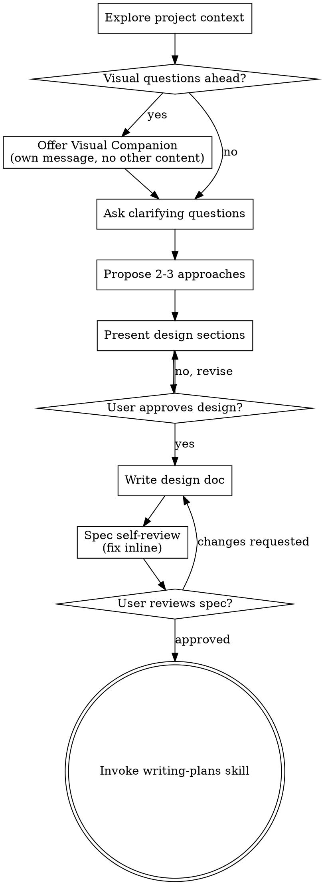

# 将创意转化为设计

通过自然的协作对话，帮助将创意转化为完整的设计和规格说明。

首先了解当前项目上下文，然后一次提一个问题来完善创意。一旦理解了要构建的内容，就展示设计并获得用户批准。

<HARD-GATE>
在你展示设计并获得用户批准之前，不要调用任何实现技能、编写任何代码、搭建任何项目结构或采取任何实现行动。这适用于每个项目，无论其看起来多么简单。
</HARD-GATE>

## 反模式："这太简单了，不需要设计"

每个项目都要经历这个过程。一个待办事项列表、一个单功能工具、一个配置更改——所有都是。"简单"的项目恰恰是未经审视的假设导致最多浪费工作的地方。设计可以很短（对于真正简单的项目只需几句话），但你必须展示它并获得批准。

## 检查清单

你必须为以下每个项目创建任务并按顺序完成：

1. **探索项目上下文** — 检查文件、文档、最近的提交
2. **提供视觉伴侣**（如果话题涉及视觉问题）— 这是单独的一条消息，不要与澄清问题合并。参见下面的视觉伴侣部分。
3. **提出澄清问题** — 一次一个，了解目的/约束/成功标准
4. **提出 2-3 种方案** — 附带权衡分析和你的推荐
5. **展示设计** — 按复杂度分节展示，每节后获得用户批准
6. **编写设计文档** — 保存到 `docs/superpowers/specs/YYYY-MM-DD-<topic>-design.md` 并提交
7. **规格自审** — 快速内联检查占位符、矛盾、模糊性和范围（见下文）
8. **用户审阅书面规格** — 请用户在继续之前审阅规格文件
9. **过渡到实现** — 调用 writing-plans 技能创建实现计划

## 流程图

**终止状态是调用 writing-plans。** 不要调用 frontend-design、mcp-builder 或任何其他实现技能。头脑风暴之后你唯一调用的技能是 writing-plans。

## 流程详情

**理解创意：**

- 首先查看当前项目状态（文件、文档、最近的提交）
- 在提出详细问题之前，评估范围：如果请求描述了多个独立子系统（例如"构建一个带有聊天、文件存储、计费和分析的平台"），立即标记这一点。不要花时间去完善一个首先需要分解的项目的细节。
- 如果项目太大，无法用单个规格说明覆盖，帮助用户分解为子项目：有哪些独立的部分，它们之间有什么关系，应该按什么顺序构建？然后通过正常的设计流程对第一个子项目进行头脑风暴。每个子项目都有自己的规格→计划→实现周期。
- 对于范围适当的项目，一次提一个问题来完善创意
- 尽可能优先使用选择题，但开放式问题也可以
- 每条消息只问一个问题——如果一个话题需要更多探索，拆分成多个问题
- 重点理解：目的、约束、成功标准

**探索方案：**

- 提出 2-3 种不同的方案及其权衡分析
- 以对话方式展示选项，附带你的推荐和理由
- 以你推荐的选项开头并解释原因

**展示设计：**

- 一旦你认为理解了要构建的内容，就展示设计
- 根据复杂度调整每节篇幅：如果简单明了用几句话，如果有细微差别则最多 200-300 字
- 每节之后询问是否目前看起来正确
- 覆盖：架构、组件、数据流、错误处理、测试
- 如果某些内容不合理，准备好回头澄清

**为隔离性和清晰性而设计：**

- 将系统拆分为更小的单元，每个单元有一个清晰的目的，通过定义良好的接口通信，并且可以独立理解和测试
- 对于每个单元，你应该能够回答：它做什么，如何使用它，它依赖什么？
- 某人能否在不阅读内部实现的情况下理解一个单元的功能？你能否在不破坏消费者的情况下更改内部实现？如果不能，边界需要改进。
- 更小、边界清晰的单元也更容易让你处理——你能更好地推理一次能放入上下文的代码，当文件聚焦时你的编辑也更可靠。当一个文件变得很大时，这通常表明它做了太多事情。

**在现有代码库中工作：**

- 在提出更改之前先探索当前结构。遵循现有模式。
- 当现有代码存在影响工作的问题时（例如文件过大、边界不清、职责纠缠），将有针对性的改进作为设计的一部分——就像一个好的开发者改进他们正在工作的代码一样。
- 不要提出不相关的重构。专注于服务当前目标的内容。

## 设计之后

**文档：**

- 将验证过的设计（规格）写入 `docs/superpowers/specs/YYYY-MM-DD-<topic>-design.md`
  - （用户对规格位置的偏好会覆盖此默认值）
- 如果可用，使用 elements-of-style:writing-clearly-and-concisely 技能
- 将设计文档提交到 git

**规格自审：**
编写规格文档后，用新的视角审视它：

1. **占位符扫描：** 有任何 "TBD"、"TODO"、不完整的部分或模糊的需求吗？修复它们。
2. **内部一致性：** 各部分之间有矛盾吗？架构与功能描述匹配吗？
3. **范围检查：** 这是否足够聚焦于单个实现计划，还是需要分解？
4. **模糊性检查：** 任何需求能否被两种不同方式解读？如果是，选择一种并明确说明。

内联修复任何问题。不需要重新审查——修复后继续。

**用户审阅关卡：**
规格审查循环通过后，在继续之前请用户审阅书面规格：

> "规格已编写并提交到 `<path>`。请审阅它，如果在我们开始编写实现计划之前有任何更改需求，请告诉我。"

等待用户的回复。如果他们要求更改，进行更改并重新运行规格审查循环。只有在用户批准后才继续。

**实现：**

- 调用 writing-plans 技能创建详细的实现计划
- 不要调用任何其他技能。writing-plans 是下一步。

## 关键原则

- **一次一个问题** - 不要用多个问题压倒对方
- **优先使用选择题** - 在可能时比开放式问题更容易回答
- **无情地执行 YAGNI** - 从所有设计中移除不必要的功能
- **探索替代方案** - 在确定之前总是提出 2-3 种方案
- **增量验证** - 展示设计，在继续之前获得批准
- **保持灵活** - 当某些内容不合理时回头澄清

## 视觉伴侣

一个基于浏览器的伴侣，用于在头脑风暴期间展示模型、图表和视觉选项。作为工具可用——不是模式。接受伴侣意味着它可以用于受益于视觉呈现的问题；这并不意味着每个问题都通过浏览器处理。

**提供伴侣：** 当你预期即将到来的问题将涉及视觉内容（模型、布局、图表）时，征求一次同意：
> "我们正在讨论的一些内容如果我能在网页浏览器中展示给你看可能会更容易解释。我可以在讨论过程中整理模型、图表、对比和其他视觉素材。这个功能还比较新，可能会消耗较多 token。想试试吗？（需要打开一个本地 URL）"

**这个提议必须是单独的一条消息。** 不要将它与澄清问题、上下文摘要或任何其他内容合并。消息应该只包含上面的提议，没有其他内容。等待用户的回复后再继续。如果他们拒绝，继续纯文本头脑风暴。

**逐问题决策：** 即使用户接受了，也要为每个问题决定是使用浏览器还是终端。测试标准：**用户通过看比通过读能更好地理解这个内容吗？**

- **使用浏览器** 处理视觉性内容——模型、线框图、布局对比、架构图、并排视觉设计
- **使用终端** 处理文本性内容——需求问题、概念选择、权衡列表、A/B/C/D 文本选项、范围决策

关于 UI 话题的问题不自动是视觉问题。"在这个上下文中个性是什么意思？"是一个概念性问题——使用终端。"哪个向导布局效果更好？"是一个视觉问题——使用浏览器。

如果他们同意使用伴侣，在继续之前阅读详细指南：
`skills/brainstorming/visual-companion.md`
