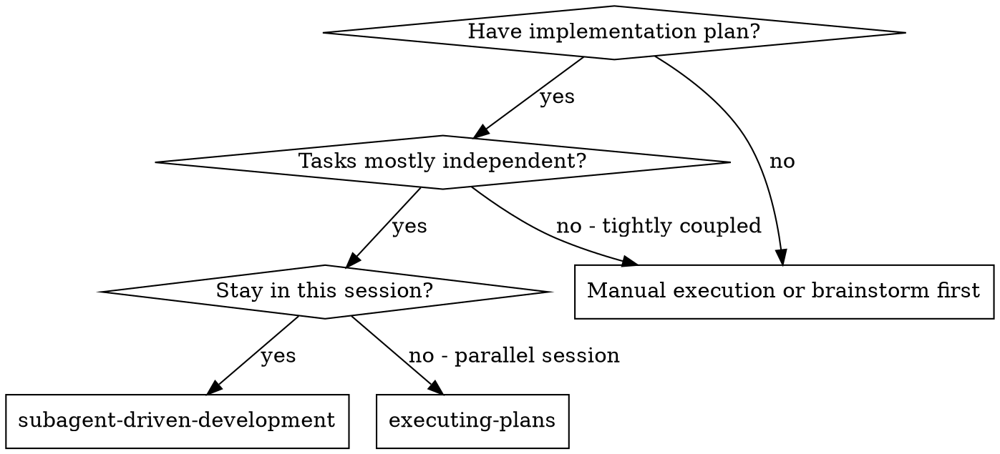
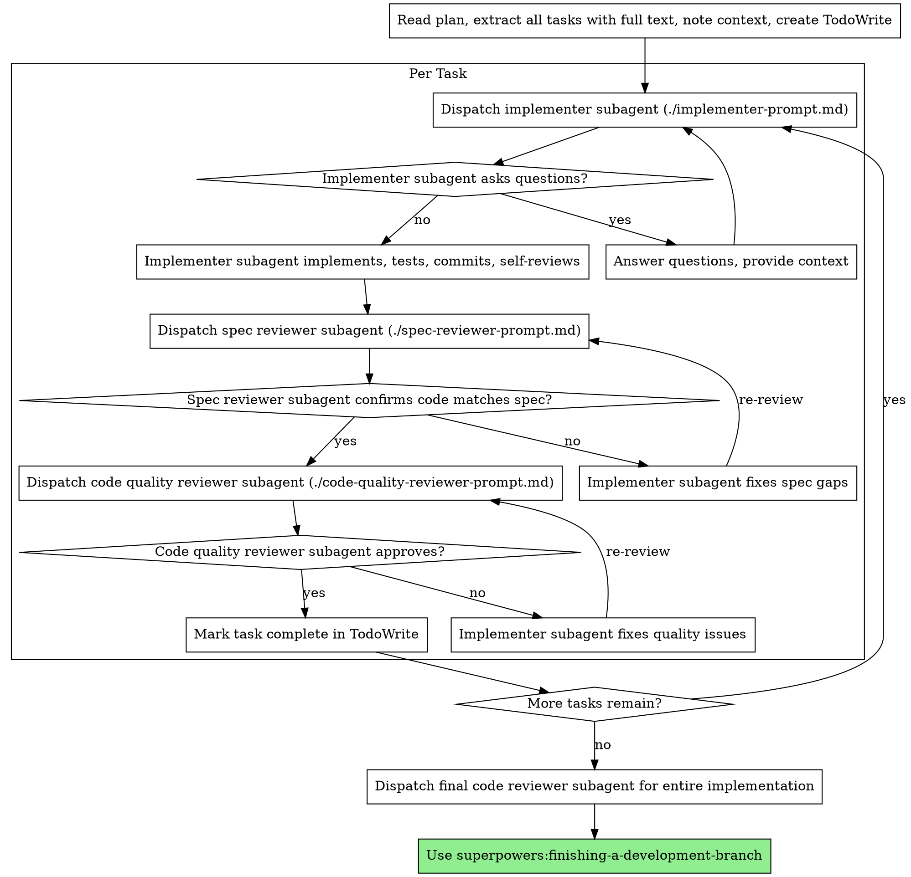

# 子代理驱动开发

通过为每个任务派遣全新的子代理来执行计划，每个任务完成后进行两阶段审查：先进行规格合规审查，再进行代码质量审查。

**为什么使用子代理：** 你将任务委派给具有隔离上下文的专用代理。通过精确构建它们的指令和上下文，确保它们保持专注并成功完成任务。它们绝不应该继承你当前会话的上下文或历史记录 -- 你只构建它们需要的内容。这也为你自己的协调工作保留了上下文。

**核心原则：** 每个任务一个新子代理 + 两阶段审查（规格再质量）= 高质量、快速迭代

**持续执行：** 不要在任务之间暂停与你的合作伙伴确认。执行计划中的所有任务，不要停止。唯一需要停止的原因是：你无法解决的 BLOCKED 状态、真正阻碍进展的歧义、或所有任务已完成。"我应该继续吗？"的提示和进度总结会浪费他们的时间 -- 他们要求你执行计划，那就执行。

## 何时使用



**vs. 执行计划（并行会话）：**
- 同一会话（无上下文切换）
- 每个任务一个新子代理（无上下文污染）
- 每个任务后两阶段审查：先规格合规，再代码质量
- 更快迭代（任务间无人工介入）

## 流程



## 模型选择

使用能够胜任每个角色的最低能力模型，以节省成本并提高速度。

**机械性实现任务**（隔离的函数、清晰的规格、1-2 个文件）：使用快速、便宜的模型。当计划规格完善时，大多数实现任务都是机械性的。

**集成和判断任务**（多文件协调、模式匹配、调试）：使用标准模型。

**架构、设计和审查任务**：使用最强的可用模型。

**任务复杂度信号：**
- 涉及 1-2 个文件且有完整规格 --> 便宜模型
- 涉及多个文件且有集成关注点 --> 标准模型
- 需要设计判断或广泛的代码库理解 --> 最强模型

## 处理实现者状态

实现者子代理报告以下四种状态之一。妥善处理每种情况：

**DONE：** 进入规格合规审查。

**DONE_WITH_CONCERNS：** 实现者完成了工作但标记了疑虑。继续之前先阅读疑虑内容。如果疑虑涉及正确性或范围，在审查前解决。如果只是观察（例如"这个文件变得很大"），记录下来并继续审查。

**NEEDS_CONTEXT：** 实现者需要未提供的信息。提供缺失的上下文并重新派遣。

**BLOCKED：** 实现者无法完成任务。评估阻碍因素：
1. 如果是上下文问题，提供更多上下文并用同一模型重新派遣
2. 如果任务需要更多推理，用更强的模型重新派遣
3. 如果任务太大，拆分为更小的部分
4. 如果计划本身有误，上报给人类

**绝不** 忽略上报或强制同一模型在无变更的情况下重试。如果实现者说卡住了，说明需要做出改变。

## 提示模板

- `./implementer-prompt.md` - 派遣实现者子代理
- `./spec-reviewer-prompt.md` - 派遣规格合规审查子代理
- `./code-quality-reviewer-prompt.md` - 派遣代码质量审查子代理

## 示例工作流

```
You: 我正在使用子代理驱动开发来执行这个计划。

[读取计划文件一次：docs/superpowers/plans/feature-plan.md]
[提取全部 5 个任务的完整文本和上下文]
[创建包含所有任务的 TodoWrite]

任务 1：Hook 安装脚本

[获取任务 1 的文本和上下文（已提取）]
[派遣实现子代理，附带完整任务文本 + 上下文]

实现者："开始前确认 -- hook 应该安装在用户级别还是系统级别？"

You: "用户级别 (~/.config/superpowers/hooks/)"

实现者："明白。现在实现..."
[稍后] 实现者:
  - 实现了 install-hook 命令
  - 添加了测试，5/5 通过
  - 自审：发现遗漏了 --force 标志，已添加
  - 已提交

[派遣规格合规审查子代理]
规格审查者：✅ 规格合规 -- 所有要求已满足，无多余内容

[获取 git SHA，派遣代码质量审查子代理]
代码审查者：优点：测试覆盖率好，代码整洁。问题：无。批准。

[标记任务 1 完成]

任务 2：恢复模式

[获取任务 2 的文本和上下文（已提取）]
[派遣实现子代理，附带完整任务文本 + 上下文]

实现者：[无问题，继续]
实现者:
  - 添加了验证/修复模式
  - 8/8 测试通过
  - 自审：一切正常
  - 已提交

[派遣规格合规审查子代理]
规格审查者：❌ 问题：
  - 缺失：进度报告（规格要求"每 100 项报告一次"）
  - 多余：添加了 --json 标志（未要求）

[实现者修复问题]
实现者：移除了 --json 标志，添加了进度报告

[规格审查者再次审查]
规格审查者：✅ 现在规格合规

[派遣代码质量审查子代理]
代码审查者：优点：扎实。问题（重要）：魔法数字 (100)

[实现者修复]
实现者：提取了 PROGRESS_INTERVAL 常量

[代码审查者再次审查]
代码审查者：✅ 批准

[标记任务 2 完成]

...

[所有任务完成后]
[派遣最终代码审查者]
最终审查者：所有要求已满足，可以合并

完成！
```

## 优势

**vs. 手动执行：**
- 子代理天然遵循 TDD
- 每个任务全新上下文（无混淆）
- 并发安全（子代理不互相干扰）
- 子代理可以提问（工作前和工作中）

**vs. 执行计划：**
- 同一会话（无交接）
- 持续进展（无等待）
- 审查检查点自动触发

**效率提升：**
- 无文件读取开销（控制器提供完整文本）
- 控制器精确策划所需上下文
- 子代理预先获得完整信息
- 问题在工作开始前暴露（而非之后）

**质量门控：**
- 自审在交接前捕获问题
- 两阶段审查：规格合规，然后代码质量
- 审查循环确保修复真正有效
- 规格合规防止过度/不足构建
- 代码质量确保实现质量良好

**成本：**
- 更多子代理调用（每个任务：实现者 + 2 个审查者）
- 控制器做更多准备工作（预先提取所有任务）
- 审查循环增加迭代
- 但早期捕获问题（比后期调试更便宜）

## 红线

**绝不：**
- 未经用户明确同意在 main/master 分支上开始实现
- 跳过审查（规格合规或代码质量）
- 在未修复问题的情况下继续
- 并行派遣多个实现子代理（会冲突）
- 让子代理读取计划文件（应提供完整文本）
- 跳过场景设定上下文（子代理需要理解任务的位置）
- 忽略子代理的问题（在让它们继续之前回答）
- 在规格合规上接受"差不多就行"（规格审查者发现问题 = 未完成）
- 跳过审查循环（审查者发现问题 = 实现者修复 = 再次审查）
- 让实现者自审替代实际审查（两者都需要）
- **在规格合规通过前开始代码质量审查**（顺序错误）
- 在任一审查存在未解决问题时进入下一个任务

**如果子代理提问：**
- 清晰完整地回答
- 需要时提供额外上下文
- 不要催促它们开始实现

**如果审查者发现问题：**
- 实现者（同一子代理）修复它们
- 审查者再次审查
- 重复直到批准
- 不要跳过再次审查

**如果子代理任务失败：**
- 派遣修复子代理并附带具体指令
- 不要尝试手动修复（上下文污染）

## 集成

**必需的工作流技能：**
- **superpowers:using-git-worktrees** - 确保隔离的工作空间（创建或验证现有）
- **superpowers:writing-plans** - 创建此技能执行的计划
- **superpowers:requesting-code-review** - 审查子代理的代码审查模板
- **superpowers:finishing-a-development-branch** - 所有任务完成后结束开发

**子代理应使用：**
- **superpowers:test-driven-development** - 子代理为每个任务遵循 TDD

**替代工作流：**
- **superpowers:executing-plans** - 用于并行会话而非同一会话执行
