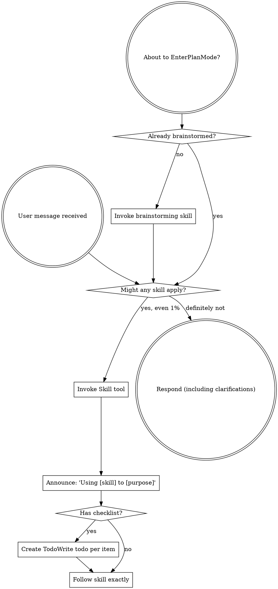

<SUBAGENT-STOP>
If you were dispatched as a subagent to execute a specific task, skip this skill.
</SUBAGENT-STOP>

<EXTREMELY-IMPORTANT>
If you think there is even a 1% chance a skill might apply to what you are doing, you ABSOLUTELY MUST invoke the skill.

IF A SKILL APPLIES TO YOUR TASK, YOU DO NOT HAVE A CHOICE. YOU MUST USE IT.

This is not negotiable. This is not optional. You cannot rationalize your way out of this.
</EXTREMELY-IMPORTANT>

## 指令优先级

Superpowers 技能覆盖默认系统提示行为，但**用户指令始终优先**：

1. **用户的明确指令**（CLAUDE.md、GEMINI.md、AGENTS.md、直接请求）——最高优先级
2. **Superpowers 技能**——在与默认系统行为冲突时覆盖之
3. **默认系统提示**——最低优先级

如果 CLAUDE.md、GEMINI.md 或 AGENTS.md 说"不要使用 TDD"而某个技能说"始终使用 TDD"，请遵循用户指令。用户拥有最终决定权。

## 如何访问技能

**在 Claude Code 中：** 使用 `Skill` 工具。当你调用一个技能时，其内容会被加载并呈现给你——直接按照它执行。不要使用 Read 工具读取技能文件。

**在 Copilot CLI 中：** 使用 `skill` 工具。技能从已安装的插件中自动发现。`skill` 工具与 Claude Code 的 `Skill` 工具工作方式相同。

**在 Gemini CLI 中：** 技能通过 `activate_skill` 工具激活。Gemini 在会话开始时加载技能元数据，并按需激活完整内容。

**在其他环境中：** 查阅你平台的文档了解如何加载技能。

## 平台适配

技能使用 Claude Code 工具名称。非 CC 平台请参阅 `references/copilot-tools.md`（Copilot CLI）、`references/codex-tools.md`（Codex）获取等效工具。Gemini CLI 用户会通过 GEMINI.md 自动加载工具映射。

# 使用技能

## 规则

**在任何回复或操作之前调用相关或请求的技能。** 即使只有 1% 的可能性某个技能适用，你也应该调用该技能来检查。如果调用的技能被证明不适合当前情况，你不需要使用它。

## 危险信号

以下想法意味着停下来——你在合理化逃避：

| 想法 | 现实 |
|------|------|
| "这只是个简单问题" | 问题也是任务。检查是否有适用的技能。 |
| "我需要先了解更多上下文" | 技能检查在澄清问题之前进行。 |
| "让我先探索代码库" | 技能告诉你如何探索。先检查。 |
| "我可以快速检查 git/文件" | 文件缺乏对话上下文。检查是否有适用的技能。 |
| "让我先收集信息" | 技能告诉你如何收集信息。 |
| "这不需要正式的技能" | 如果技能存在，就使用它。 |
| "我记得这个技能" | 技能会演进。请阅读当前版本。 |
| "这不算一个任务" | 行动 = 任务。检查是否有适用的技能。 |
| "技能是杀鸡用牛刀" | 简单的事情会变复杂。使用它。 |
| "我先做这一件事" | 在做任何事之前先检查。 |
| "这感觉很高效" | 无纪律的行动浪费时间。技能可以防止这种情况。 |
| "我知道那是什么意思" | 知道概念 ≠ 使用技能。调用它。 |

## 技能优先级

当多个技能可能适用时，按以下顺序：

1. **流程技能优先**（brainstorming、debugging）——这些决定了如何处理任务
2. **实现技能其次**（frontend-design、mcp-builder）——这些指导执行

"我们来构建 X" → 先 brainstorming，然后实现技能。
"修复这个 bug" → 先 debugging，然后领域特定技能。

## 技能类型

**刚性**（TDD、debugging）：严格遵循。不要因适应而丢弃纪律。

**柔性**（patterns）：根据上下文调整原则。

技能本身会告诉你属于哪种类型。

## 用户指令

指令说的是 WHAT，不是 HOW。"添加 X"或"修复 Y"不意味着跳过工作流程。
