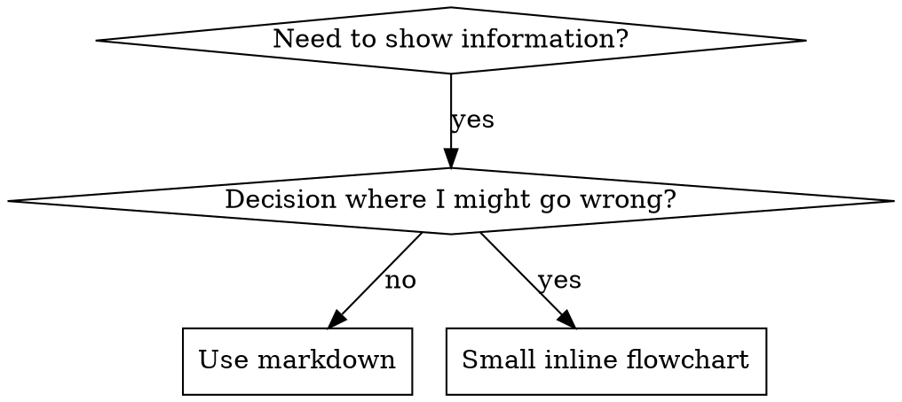

# 编写技能

## 概述

**编写技能就是将 TDD 应用于流程文档。**

**个人技能存放在 agent 特定目录中（Claude Code 为 `~/.claude/skills`，Codex 为 `~/.agents/skills/`）**

你编写测试用例（用子 agent 的压力场景），观察它们失败（基线行为），编写技能（文档），观察测试通过（agent 遵循），然后重构（堵住漏洞）。

**核心原则：** 如果你没有看到 agent 在没有技能时失败，你就不知道技能是否教了正确的东西。

**必需背景：** 在使用此技能之前，你必须理解 superpowers:test-driven-development。该技能定义了基本的红-绿-重构循环。此技能将 TDD 适配到文档。

**官方指南：** 关于 Anthropic 官方的技能编写最佳实践，请参阅 anthropic-best-practices.md。该文档提供了与此技能中 TDD 方法互补的额外模式和指南。

## 什么是技能？

**技能**是经过验证的技术、模式或工具的参考指南。技能帮助未来的 Claude 实例找到并应用有效的方法。

**技能是：** 可复用的技术、模式、工具、参考指南

**技能不是：** 关于你如何解决过一个问题的叙述

## 技能的 TDD 映射

| TDD 概念 | 技能创建 |
|----------|----------|
| **测试用例** | 用子 agent 的压力场景 |
| **生产代码** | 技能文档（SKILL.md） |
| **测试失败（红）** | Agent 在没有技能时违反规则（基线） |
| **测试通过（绿）** | Agent 在有技能时遵循规则 |
| **重构** | 在保持遵循的同时堵住漏洞 |
| **先写测试** | 在编写技能之前运行基线场景 |
| **观察失败** | 记录 agent 使用的确切合理化说辞 |
| **最简代码** | 编写技能解决那些特定违规 |
| **观察通过** | 验证 agent 现在遵循了 |
| **重构循环** | 发现新的合理化 → 堵住 → 重新验证 |

整个技能创建过程遵循红-绿-重构。

## 何时创建技能

**创建条件：**
- 技术对你来说不是直觉显而易见的
- 你会在项目间再次引用它
- 模式具有广泛适用性（非项目特定）
- 其他人会受益

**不要创建：**
- 一次性解决方案
- 在其他地方有良好文档的标准实践
- 项目特定的约定（放在 CLAUDE.md 中）
- 机械性约束（如果可以用 regex/验证强制执行，就自动化——把文档留给需要判断的地方）

## 技能类型

### 技术
具有具体步骤的可跟随方法（condition-based-waiting、root-cause-tracing）

### 模式
思考问题的方式（flatten-with-flags、test-invariants）

### 参考
API 文档、语法指南、工具文档（office docs）

## 目录结构

```
skills/
  skill-name/
    SKILL.md              # 主参考（必需）
    supporting-file.*     # 仅在需要时
```

**扁平命名空间** - 所有技能在一个可搜索的命名空间中

**独立文件用于：**
1. **重量级参考**（100+ 行）- API 文档、全面语法
2. **可复用工具** - 脚本、工具、模板

**内联保留：**
- 原则和概念
- 代码模式（< 50 行）
- 其他所有内容

## SKILL.md 结构

**Frontmatter（YAML）：**
- 两个必需字段：`name` 和 `description`（参见 [agentskills.io/specification](https://agentskills.io/specification) 了解所有支持字段）
- 总计最多 1024 个字符
- `name`：仅使用字母、数字和连字符（无括号、特殊字符）
- `description`：第三人称，仅描述何时使用（不是做什么）
  - 以"Use when..."开头以聚焦触发条件
  - 包含具体症状、情境和上下文
  - **永远不要在描述中总结技能的流程或工作流**（参见 CSO 章节了解原因）
  - 尽量保持在 500 个字符以内

```markdown
---
name: Skill-Name-With-Hyphens
description: Use when [specific triggering conditions and symptoms]
---

# 技能名称

## 概述
这是什么？1-2 句话的核心原则。

## 何时使用
[小型内联流程图——如果决策不明显]

带症状和用例的要点列表
何时不使用

## 核心模式（用于技术/模式）
前后代码对比

## 快速参考
表格或要点用于快速扫描常见操作

## 实现
简单模式的内联代码
重量级参考或可复用工具的链接到文件

## 常见错误
什么会出错 + 修复

## 实际影响（可选）
具体结果
```


## Claude 搜索优化（CSO）

**对发现至关重要：** 未来的 Claude 需要找到你的技能

### 1. 丰富的描述字段

**目的：** Claude 读取描述来决定为给定任务加载哪些技能。让它回答："我现在应该读这个技能吗？"

**格式：** 以"Use when..."开头以聚焦触发条件

**关键：描述 = 何时使用，不是技能做什么**

描述应该只描述触发条件。不要在描述中总结技能的流程或工作流。

**为什么这很重要：** 测试表明，当描述总结了技能的工作流时，Claude 可能会遵循描述而不是阅读完整的技能内容。一个说"在任务之间进行代码审查"的描述导致 Claude 做了一次审查，而技能的流程图清楚地显示了两次审查（规格合规性然后代码质量）。

当描述改为只是"在当前会话中执行具有独立任务的实现计划时使用"（没有工作流总结），Claude 正确地阅读了流程图并遵循了两阶段审查过程。

**陷阱：** 总结工作流的描述创造了 Claude 会走的捷径。技能正文变成了 Claude 跳过的文档。

```yaml
# ❌ 差：总结工作流——Claude 可能遵循这个而不是阅读技能
description: Use when executing plans - dispatches subagent per task with code review between tasks

# ❌ 差：太多流程细节
description: Use for TDD - write test first, watch it fail, write minimal code, refactor

# ✅ 好：只写触发条件，没有工作流总结
description: Use when executing implementation plans with independent tasks in the current session

# ✅ 好：仅触发条件
description: Use when implementing any feature or bugfix, before writing implementation code
```

**内容：**
- 使用具体的触发器、症状和情境来表明此技能适用
- 描述*问题*（竞态条件、不一致行为）而非*语言特定症状*（setTimeout、sleep）
- 保持触发器技术无关，除非技能本身是技术特定的
- 如果技能是技术特定的，在触发器中明确说明
- 使用第三人称（注入到系统提示中）
- **永远不要在描述中总结技能的流程或工作流**

```yaml
# ❌ 差：太抽象、模糊，没有说明何时使用
description: For async testing

# ❌ 差：第一人称
description: I can help you with async tests when they're flaky

# ❌ 差：提到技术但技能并非特定于它
description: Use when tests use setTimeout/sleep and are flaky

# ✅ 好：以"Use when"开头，描述问题，没有工作流
description: Use when tests have race conditions, timing dependencies, or pass/fail inconsistently

# ✅ 好：技术特定技能带明确触发器
description: Use when using React Router and handling authentication redirects
```

### 2. 关键词覆盖

使用 Claude 会搜索的词汇：
- 错误信息："Hook timed out"、"ENOTEMPTY"、"race condition"
- 症状："flaky"、"hanging"、"zombie"、"pollution"
- 同义词："timeout/hang/freeze"、"cleanup/teardown/afterEach"
- 工具：实际命令、库名、文件类型

### 3. 描述性命名

**使用主动语态，动词优先：**
- ✅ `creating-skills` 而非 `skill-creation`
- ✅ `condition-based-waiting` 而非 `async-test-helpers`

### 4. Token 效率（关键）

**问题：** getting-started 和频繁引用的技能会加载到每个对话中。每个 token 都很重要。

**目标字数：**
- getting-started 工作流：每个 <150 词
- 频繁加载的技能：总计 <200 词
- 其他技能：<500 词（仍需简洁）

**技巧：**

**将细节移到工具帮助中：**
```bash
# ❌ 差：在 SKILL.md 中记录所有标志
search-conversations supports --text, --both, --after DATE, --before DATE, --limit N

# ✅ 好：引用 --help
search-conversations supports multiple modes and filters. Run --help for details.
```

**使用交叉引用：**
```markdown
# ❌ 差：重复工作流细节
When searching, dispatch subagent with template...
[20 行重复指令]

# ✅ 好：引用其他技能
Always use subagents (50-100x context savings). REQUIRED: Use [other-skill-name] for workflow.
```

**压缩示例：**
```markdown
# ❌ 差：冗长示例（42 词）
your human partner: "How did we handle authentication errors in React Router before?"
You: I'll search past conversations for React Router authentication patterns.
[Dispatch subagent with search query: "React Router authentication error handling 401"]

# ✅ 好：精简示例（20 词）
Partner: "How did we handle auth errors in React Router?"
You: Searching...
[Dispatch subagent → synthesis]
```

**消除冗余：**
- 不要重复交叉引用技能中的内容
- 不要解释命令本身就很清楚的内容
- 不要包含同一模式的多个示例

**验证：**
```bash
wc -w skills/path/SKILL.md
# getting-started 工作流：目标每个 <150
# 其他频繁加载的：目标总计 <200
```

**按你做什么或核心洞察命名：**
- ✅ `condition-based-waiting` > `async-test-helpers`
- ✅ `using-skills` 而非 `skill-usage`
- ✅ `flatten-with-flags` > `data-structure-refactoring`
- ✅ `root-cause-tracing` > `debugging-techniques`

**动名词（-ing）很适合流程：**
- `creating-skills`、`testing-skills`、`debugging-with-logs`
- 主动，描述你正在采取的动作

### 4. 交叉引用其他技能

**编写引用其他技能的文档时：**

仅使用技能名称，带明确的要求标记：
- ✅ 好：`**REQUIRED SUB-SKILL:** Use superpowers:test-driven-development`
- ✅ 好：`**REQUIRED BACKGROUND:** You MUST understand superpowers:systematic-debugging`
- ❌ 差：`See skills/testing/test-driven-development`（不清楚是否必需）
- ❌ 差：`@skills/testing/test-driven-development/SKILL.md`（强制加载，消耗上下文）

**为什么不用 @ 链接：** `@` 语法会立即强制加载文件，在你需要之前就消耗 200k+ 上下文。

## 流程图使用



**流程图仅用于：**
- 不明显的决策点
- 你可能过早停止的流程循环
- "何时使用 A vs B"的决策

**不要将流程图用于：**
- 参考资料 → 表格、列表
- 代码示例 → Markdown 代码块
- 线性指令 → 编号列表
- 没有语义意义的标签（step1、helper2）

参见 @graphviz-conventions.dot 了解 graphviz 样式规则。

**为你的人类搭档可视化：** 使用此目录中的 `render-graphs.js` 将技能的流程图渲染为 SVG：
```bash
./render-graphs.js ../some-skill           # 每个图单独渲染
./render-graphs.js ../some-skill --combine # 所有图合并为一个 SVG
```

## 代码示例

**一个优秀的示例胜过许多平庸的示例**

选择最相关的语言：
- 测试技术 → TypeScript/JavaScript
- 系统调试 → Shell/Python
- 数据处理 → Python

**好示例：**
- 完整且可运行
- 好的注释解释 WHY
- 来自真实场景
- 清晰展示模式
- 可直接适配（不是通用模板）

**不要：**
- 用 5+ 种语言实现
- 创建填空模板
- 编写刻意的示例

你擅长移植——一个好的示例就够了。

## 文件组织

### 自包含技能
```
defense-in-depth/
  SKILL.md    # 所有内容内联
```
适用：所有内容可以容纳，不需要重量级参考

### 带可复用工具的技能
```
condition-based-waiting/
  SKILL.md    # 概述 + 模式
  example.ts  # 可适配的工作辅助函数
```
适用：工具是可复用代码，而非仅仅是叙述

### 带重量级参考的技能
```
pptx/
  SKILL.md       # 概述 + 工作流
  pptxgenjs.md   # 600 行 API 参考
  ooxml.md       # 500 行 XML 结构
  scripts/       # 可执行工具
```
适用：参考资料太大无法内联

## 铁律（与 TDD 相同）

```
没有失败的测试，就没有技能
```

这适用于新技能和对现有技能的编辑。

在测试之前编写技能？删除它。重新开始。
编辑技能时没有测试？同样的违规。

**没有例外：**
- 不因为"简单的添加"
- 不因为"只是加一个章节"
- 不因为"文档更新"
- 不要保留未测试的变更作为"参考"
- 不要在运行测试时"适配"
- 删除就是删除

**必需背景：** superpowers:test-driven-development 技能解释了为什么这很重要。相同原则适用于文档。

## 测试所有技能类型

不同的技能类型需要不同的测试方法：

### 纪律强制技能（规则/要求）

**示例：** TDD、verification-before-completion、designing-before-coding

**测试方式：**
- 学术问题：他们理解规则吗？
- 压力场景：他们在压力下遵循吗？
- 多重压力组合：时间 + 沉没成本 + 疲惫
- 识别合理化并添加明确对策

**成功标准：** Agent 在最大压力下遵循规则

### 技术技能（操作指南）

**示例：** condition-based-waiting、root-cause-tracing、defensive-programming

**测试方式：**
- 应用场景：他们能正确应用技术吗？
- 变体场景：他们处理边界情况吗？
- 缺失信息测试：指令有漏洞吗？

**成功标准：** Agent 成功将技术应用于新场景

### 模式技能（心智模型）

**示例：** reducing-complexity、information-hiding 概念

**测试方式：**
- 识别场景：他们能识别模式何时适用吗？
- 应用场景：他们能使用心智模型吗？
- 反例：他们知道何时不应用吗？

**成功标准：** Agent 正确识别何时/如何应用模式

### 参考技能（文档/API）

**示例：** API 文档、命令参考、库指南

**测试方式：**
- 检索场景：他们能找到正确的信息吗？
- 应用场景：他们能正确使用找到的信息吗？
- 差距测试：常见用例是否被覆盖？

**成功标准：** Agent 找到并正确应用参考信息

## 跳过测试的常见合理化

| 借口 | 现实 |
|------|------|
| "技能显然很清楚" | 对你清楚 ≠ 对其他 agent 清楚。测试它。 |
| "这只是个参考" | 参考可能有漏洞、不清楚的章节。测试检索。 |
| "测试是杀鸡用牛刀" | 未测试的技能有问题。总是如此。15 分钟测试节省数小时。 |
| "如果出现问题我再测试" | 问题 = agent 无法使用技能。在部署前测试。 |
| "太繁琐了" | 测试比调试生产中的坏技能更不繁琐。 |
| "我确信它很好" | 过度自信保证出问题。无论如何测试。 |
| "学术审查就够了" | 阅读 ≠ 使用。测试应用场景。 |
| "没时间测试" | 部署未测试的技能之后修复会浪费更多时间。 |

**所有这些都意味着：部署前测试。没有例外。**

## 使技能抵御合理化

强制纪律的技能（如 TDD）需要抵抗合理化。Agent 很聪明，在压力下会找漏洞。

**心理学说明：** 理解说服技术为何有效有助于你系统地应用它们。参见 persuasion-principles.md 了解研究基础（Cialdini, 2021; Meincke et al., 2025）关于权威、承诺、稀缺、社会证明和统一原则。

### 明确堵住每个漏洞

不要只陈述规则——禁止具体的变通方法：

<Bad>
```markdown
在测试之前编写代码？删除它。
```
</Bad>

<Good>
```markdown
在测试之前编写代码？删除它。重新开始。

**没有例外：**
- 不要保留它作为"参考"
- 不要在编写测试时"适配"它
- 不要看它
- 删除就是删除
```
</Good>

### 处理"精神 vs 字面"论点

尽早添加基础原则：

```markdown
**违反规则的字面意思就是违反规则的精神。**
```

这切断了整类"我在遵循精神"的合理化。

### 构建合理化表格

从基线测试中捕获合理化（参见下面的测试章节）。Agent 做的每个借口都放进表格：

```markdown
| 借口 | 现实 |
|------|------|
| "太简单了不需要测试" | 简单代码会出错。测试只需 30 秒。 |
| "我之后再测" | 立即通过的测试什么都证明不了。 |
| "之后测试能达到同样目标" | 之后测试 = "这做了什么？"先测试 = "这应该做什么？" |
```

### 创建危险信号列表

让 agent 在合理化时容易自我检查：

```markdown
## 危险信号——停下来重新开始

- 在测试之前编写代码
- "我已经手动测试过了"
- "之后测试能达到同样目的"
- "这是关于精神不是仪式"
- "这不一样因为..."

**所有这些都意味着：删除代码。用 TDD 重新开始。**
```

### 更新 CSO 以包含违规症状

添加到描述：你即将违反规则时的症状：

```yaml
description: use when implementing any feature or bugfix, before writing implementation code
```

## 技能的红-绿-重构

遵循 TDD 循环：

### 红：编写失败测试（基线）

在没有技能的情况下用子 agent 运行压力场景。记录确切行为：
- 他们做了什么选择？
- 他们使用了什么合理化说辞（逐字记录）？
- 哪些压力触发了违规？

这是"观察测试失败"——你必须在编写技能之前看到 agent 自然会做什么。

### 绿：编写最简技能

编写技能解决那些特定的合理化。不要为假设情况添加额外内容。

在有技能的情况下运行相同场景。Agent 现在应该遵循了。

### 重构：堵住漏洞

Agent 找到了新的合理化？添加明确对策。重新测试直到坚不可摧。

**测试方法论：** 参见 @testing-skills-with-subagents.md 了解完整测试方法论：
- 如何编写压力场景
- 压力类型（时间、沉没成本、权威、疲惫）
- 系统地堵住漏洞
- 元测试技术

## 反模式

### ❌ 叙述性示例
"在 2025-10-03 的会话中，我们发现空的 projectDir 导致了..."
**为什么差：** 太具体，不可复用

### ❌ 多语言稀释
example-js.js、example-py.py、example-go.go
**为什么差：** 质量平庸，维护负担

### ❌ 流程图中的代码
```dot
step1 [label="import fs"];
step2 [label="read file"];
```
**为什么差：** 无法复制粘贴，难以阅读

### ❌ 通用标签
helper1、helper2、step3、pattern4
**为什么差：** 标签应该有语义意义

## 停下来：在进入下一个技能之前

**编写任何技能后，你必须停下来完成部署流程。**

**不要：**
- 批量创建多个技能而不逐个测试
- 在当前技能验证之前进入下一个
- 因为"批量更高效"而跳过测试

**下面的部署检查清单对每个技能都是强制性的。**

部署未测试的技能 = 部署未测试的代码。这是违反质量标准的。

## 技能创建检查清单（TDD 适配）

**重要：使用 TodoWrite 为下面检查清单的每个项目创建待办事项。**

**红阶段——编写失败测试：**
- [ ] 创建压力场景（纪律技能需要 3+ 个组合压力）
- [ ] 在没有技能的情况下运行场景——逐字记录基线行为
- [ ] 识别合理化/失败中的模式

**绿阶段——编写最简技能：**
- [ ] 名称仅使用字母、数字、连字符（无括号/特殊字符）
- [ ] YAML frontmatter 带必需的 `name` 和 `description` 字段（最多 1024 字符；参见 [spec](https://agentskills.io/specification)）
- [ ] 描述以"Use when..."开头并包含具体触发器/症状
- [ ] 描述使用第三人称编写
- [ ] 全文关键词覆盖以供搜索（错误、症状、工具）
- [ ] 清晰的概述和核心原则
- [ ] 解决红阶段识别的特定基线失败
- [ ] 代码内联或链接到独立文件
- [ ] 一个优秀的示例（不是多语言）
- [ ] 在有技能的情况下运行场景——验证 agent 现在遵循了

**重构阶段——堵住漏洞：**
- [ ] 从测试中识别新的合理化
- [ ] 添加明确对策（如果是纪律技能）
- [ ] 从所有测试迭代构建合理化表格
- [ ] 创建危险信号列表
- [ ] 重新测试直到坚不可摧

**质量检查：**
- [ ] 仅在决策不明显时使用小型流程图
- [ ] 快速参考表格
- [ ] 常见错误章节
- [ ] 没有叙述性故事
- [ ] 仅为工具或重量级参考使用支持文件

**部署：**
- [ ] 将技能提交到 git 并推送到你的 fork（如果已配置）
- [ ] 考虑通过 PR 贡献回来（如果有广泛用途）

## 发现工作流

未来的 Claude 如何找到你的技能：

1. **遇到问题**（"测试不稳定"）
3. **找到 SKILL**（描述匹配）
4. **扫描概述**（这相关吗？）
5. **阅读模式**（快速参考表格）
6. **加载示例**（仅在实现时）

**为此流程优化**——尽早且频繁地放置可搜索的术语。

## 底线

**创建技能就是流程文档的 TDD。**

同样的铁律：没有失败的测试，就没有技能。
同样的循环：红（基线）→ 绿（编写技能）→ 重构（堵住漏洞）。
同样的好处：更好的质量、更少的意外、坚不可摧的结果。

如果你为代码遵循 TDD，也为技能遵循它。这是应用于文档的相同纪律。
